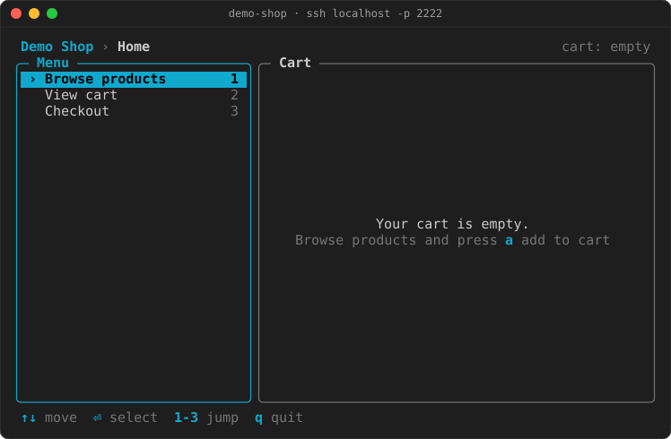
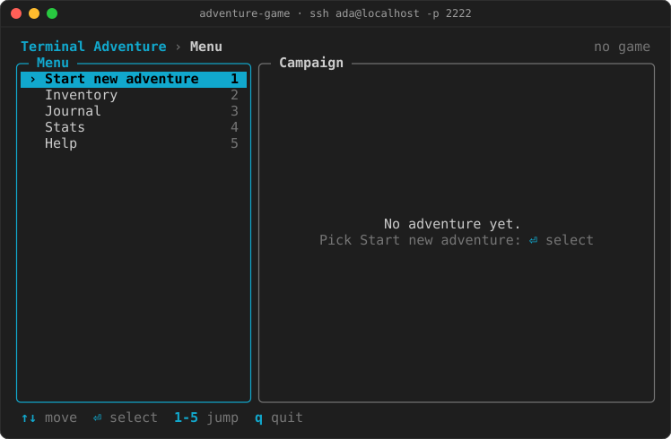
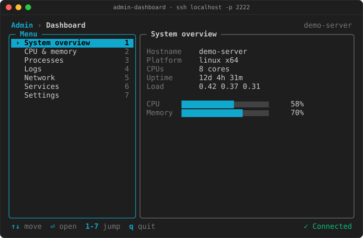
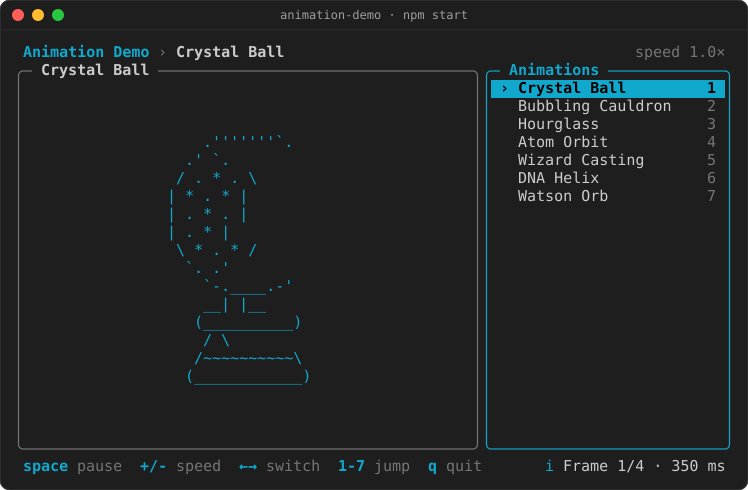

# shellcraft: SSH Terminal App Generator

> Build terminal apps that people use over SSH

## What is This?

A project generator and four demo apps for SSH terminal apps in Node.js. An
[ssh2](https://github.com/mscdex/ssh2) server runs one
[Ink](https://github.com/vadimdemedes/ink) app (React for the terminal) per
SSH session. Users connect with any SSH client; there is nothing to install
on their side.

The screens come from one shared package, [`@shellcraft/ui`](ui/README.md):
title bar, status bar, panels, lists, tables, form fields, meters, a theme,
test helpers, and `serve()`, which runs an Ink app on an SSH channel.

```
 Demo Shop › Home                                              cart: 3 · $69.97
╭─ Menu ─────────────────────╮╭─ Cart ─────────────────────────────────────────╮
│ › Browse products        1 ││                                                │
│   View cart              2 ││ Developer Blend         2 × $24.99             │
│   Checkout               3 ││ Terminal Espresso       1 × $19.99             │
│                            ││                                                │
│                            ││ Total                   $69.97                 │
│                            ││                                                │
╰────────────────────────────╯╰────────────────────────────────────────────────╯
 ↑↓ move  ⏎ select  1-3 jump  q quit
```

## Features

- **SSH server**: anonymous or public key sign-in, one session per connection
- **Ink UI**: screens built from `@shellcraft/ui` components, one design for all apps
- **Works over SSH**: terminal size, resize, colors, CRLF, alternate screen and cleanup handled by `serve()`
- **Generator**: `init.sh` creates a new app (`minimal` or `ecommerce`) with tests
- **Four demo apps**: a shop, a text adventure with an LLM, a system dashboard, and animations
- **Tests**: Node's built-in test runner; screen tests on a fake terminal, SSH tests against a real server

## Security Notice

All demo apps and generated apps accept anonymous SSH connections. They are
for **local development and demos only**. Before you expose a server to a
network, add real authentication, rate limiting and access control.

## Demo Apps

All four apps use Ink through `@shellcraft/ui`. The recordings below are the
real apps at 80×24, rendered frame by frame by `scripts/record-readme.mjs`.

### demo-shop: e-commerce

A storefront: product table, cart, and a checkout form with validation. It is
the reference app for the generator's `ecommerce` template.

<p align="center">
  
</p>

### adventure-game: text RPG with an LLM

A text adventure narrated by a Game Master LLM through [Ollama](https://ollama.com/):

- deterministic game rules; the LLM only narrates (`OLLAMA_MODEL` picks the model)
- games saved to `data/sessions.json` for the player's SSH key, so the same key continues the game (a login name alone does not; without a key the game is not saved)
- free-text input to the Game Master next to suggested actions
- a busy spinner in the status bar while the LLM answers
- strict checks on the LLM's answers (invalid payloads fail fast)

<p align="center">
  
</p>

### admin-dashboard: system monitoring

A dashboard for the machine it runs on: overview, processes, resources, logs,
network, services and settings, refreshed live.

<p align="center">
  
</p>

### animation-demo: terminal animations

ASCII animations with speed control and pause. It runs in your local terminal
(no SSH) through `renderLocal()`. Useful as a reference for loading screens.

<p align="center">
  
</p>

## Quick Start

You need Node.js 22 or newer and an SSH client.

### Generate a New App

```bash
./init.sh my-app              # minimal starter (the default)
./init.sh my-app ecommerce    # products, cart and checkout
```

```bash
cd my-app
npm install
npm test
npm run generate-keys
npm start
```

### Run a Demo App

Inside this repository, use the `./npmw` wrapper in each app directory. It
loads `nvm` when `node` or `npm` is not on your PATH.

```bash
cd demo-shop          # or adventure-game, admin-dashboard
./npmw install
./npmw run generate-keys
./npmw start
```

`animation-demo` needs only `./npmw install` and `./npmw start`.
`./quick-start.sh` offers all of this as a menu.

### Connect

```bash
ssh localhost -p 2222
```

Each app listens on port 2222 (set `SSH_PORT` in `.env`). `q` quits, Ctrl-C
always quits.

## Project Structure

```
shellcraft/
├── init.sh                  # app generator
├── quick-start.sh           # menu: run a demo, run tests, create an app
├── ui/                      # @shellcraft/ui: Ink components, theme, serve(), test helpers
├── demo-shop/               # e-commerce demo
├── adventure-game/          # text RPG with an LLM
├── admin-dashboard/         # system monitoring dashboard
├── animation-demo/          # ASCII animations (local terminal)
└── *.md                     # documentation (see INDEX.md)
```

The demo apps depend on `"@shellcraft/ui": "file:../ui"`. Their `.npmrc`
sets `install-links=true`, so npm copies `ui/` into each app's
`node_modules` (one React). After you change `ui/`, run `./npmw ci` in the app.

### Generated App Structure

```
my-app/
├── src/
│   ├── config.js            # app name for the title bar
│   ├── server/
│   │   ├── index.js         # SSH server
│   │   ├── auth.js          # who gets in: a verified key, or anonymous
│   │   ├── router.js        # passes each shell to serve()
│   │   └── session.js       # one session per connection
│   ├── ui/
│   │   ├── app.js           # current screen, status message, ctx
│   │   └── *.js             # one file per screen
│   └── models/              # data (ecommerce)
├── test/
│   ├── unit/                # sessions, screens, SSH adapter
│   ├── e2e/                 # the real SSH server
│   └── helpers/
├── vendor/ui/               # copy of @shellcraft/ui
├── scripts/generate-keys.js # SSH host key
├── keys/                    # host key (generated, git-ignored)
└── package.json, .env.example
```

A generated app is self-contained: it depends on
`"@shellcraft/ui": "file:./vendor/ui"`, so it does not need this repository.

## Technology Stack

- **[ssh2](https://github.com/mscdex/ssh2)**: SSH server
- **[Ink](https://github.com/vadimdemedes/ink) 8 and React 19**: the UI, through [`@shellcraft/ui`](ui/README.md)
- **[dotenv](https://github.com/motdotla/dotenv)**: configuration from `.env`
- **[nanoid](https://github.com/ai/nanoid)**: session ids
- **Node's test runner** (`node:test`): all tests

adventure-game also talks to **Ollama** over HTTP for local LLM answers. Ollama
runs as a separate service and is not an npm dependency.

## Creating a Screen

A screen is a function component. It gets `ctx` from `src/ui/app.js`:

```js
import React from 'react';
import { Screen, Panel, Text, useInput } from '@shellcraft/ui';

const h = React.createElement;

export function HelloScreen({ ctx }) {
  useInput((input, key) => {
    if (input === 'b' || key.escape) ctx.navigate('home');
  });

  return h(
    Screen,
    { app: 'My App', screen: 'Hello', hints: [['b', 'back'], ['q', 'quit']], message: ctx.message },
    h(Panel, { title: 'Hello', focused: true }, h(Text, null, 'Hello from Ink.'))
  );
}
```

Add it to `screens` in `src/ui/app.js` and open it with `ctx.navigate('hello')`.
[USAGE_GUIDE.md](USAGE_GUIDE.md) shows menus, tables, forms and messages.

## Design Rules

One title bar and one status bar per screen. Key hints read `q quit`. Colors
only through the theme helpers. No floating boxes: results go to the status
bar. No Exit menu items. The full rules, and why Ink needs care over SSH, are
in [DESIGN_PRINCIPLES.md](DESIGN_PRINCIPLES.md). The visual reference is the
[Figma file](https://www.figma.com/design/oykSSRdp0xDbaot7ZkLFQc).

## Documentation

- **[GETTING_STARTED.md](GETTING_STARTED.md)**: step by step, with troubleshooting
- **[USAGE_GUIDE.md](USAGE_GUIDE.md)**: build and change screens, sessions, APIs, LLMs, deployment
- **[QUICK_REFERENCE.md](QUICK_REFERENCE.md)**: commands and component cheat sheet
- **[DESIGN_PRINCIPLES.md](DESIGN_PRINCIPLES.md)**: screen rules and Ink over SSH
- **[ui/README.md](ui/README.md)**: every component, the theme, `serve()` and the test helpers
- **[INDEX.md](INDEX.md)**: all documents

## License

MIT License: free to use for any project, commercial or personal.
